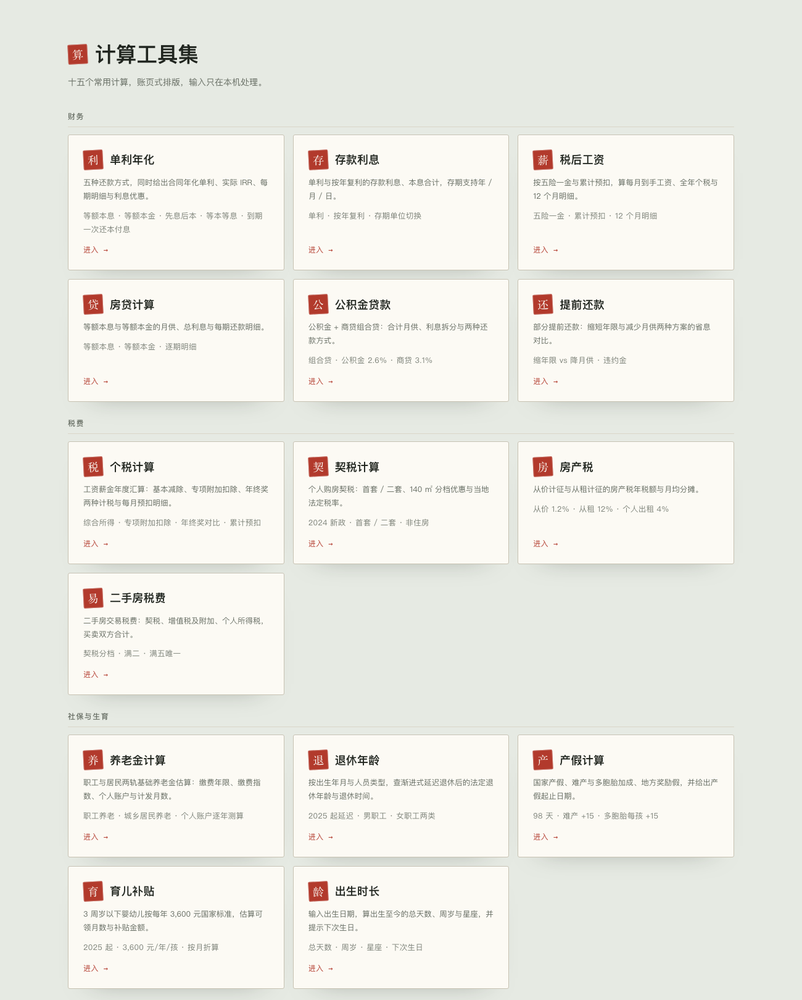
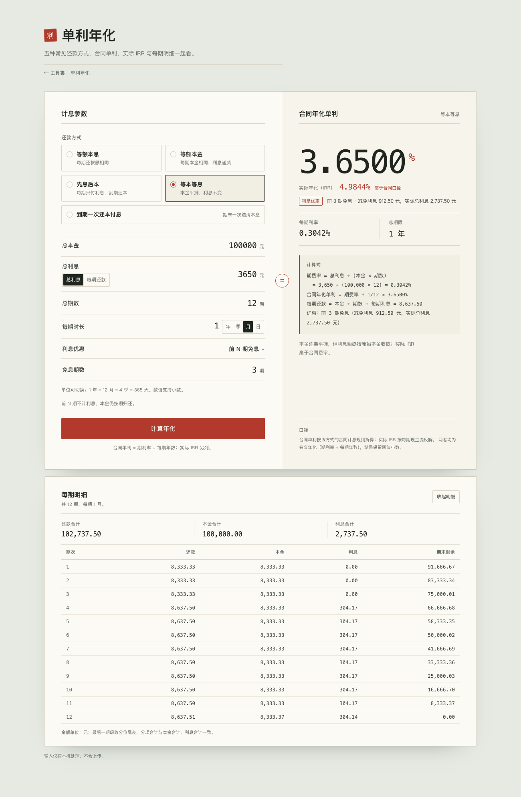
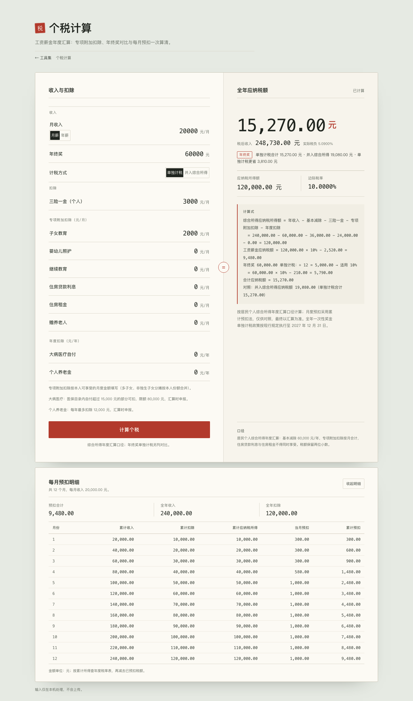
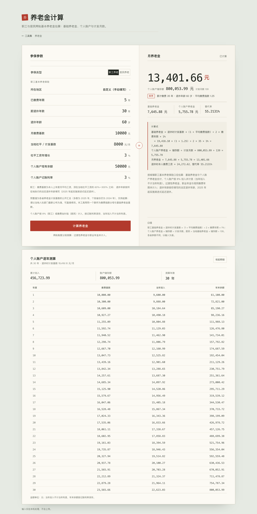
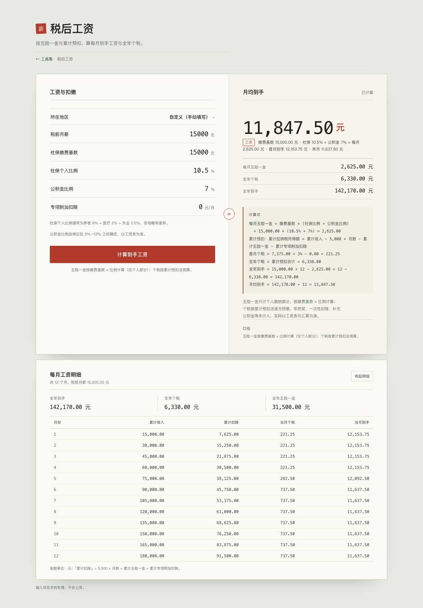
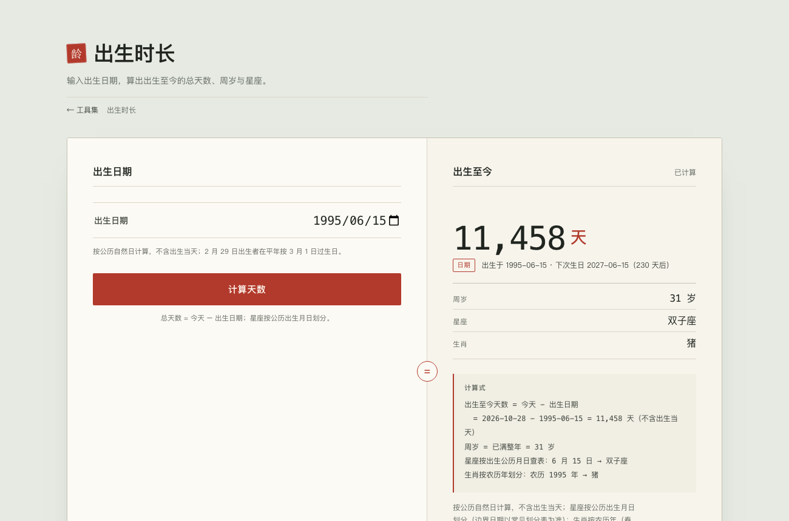
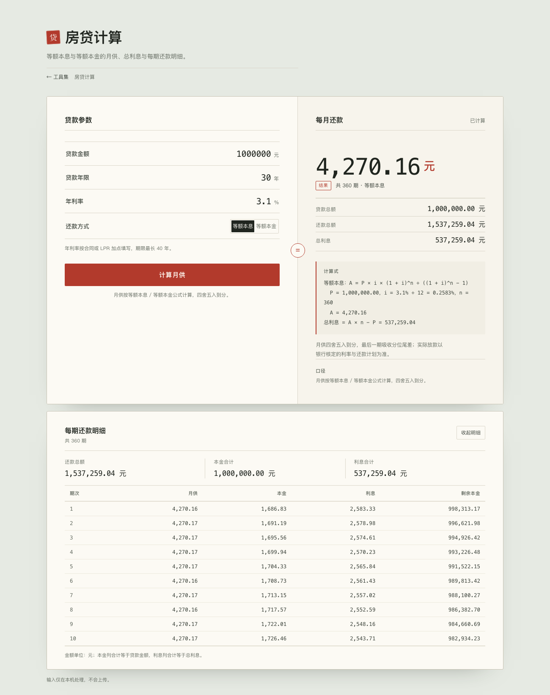

# 计算工具集（Calculator Toolkit）

仓库：<https://github.com/FGBraKing/calculator-toolkit>（英文目录与仓库名，避免中文路径的编码问题）。

一个小型计算工具集合：纯 Python（FastAPI）+ 无构建步骤的 HTML/CSS/JS，
所有计算都在本机服务中完成。首页是工具导航，每个工具是独立页面，共享同一套「账页」视觉。



| 工具 | 页面 | 接口 | 说明 |
|---|---|---|---|
| 单利年化 | `/interest/` | `POST /api/calculate` | 五种还款方式，合同单利、实际 IRR、每期明细与利息优惠 |
| 存款利息 | `/deposit/` | `POST /api/deposit/calculate` | 单利与按年复利，存期支持年 / 月 / 日 |
| 税后工资 | `/salary/` | `POST /api/salary/calculate` | 五险一金、累计预扣与每月到手 |
| 房贷计算 | `/mortgage/` | `POST /api/mortgage/calculate` | 等额本息 / 等额本金月供、总利息与逐期明细 |
| 公积金贷款 | `/fund-loan/` | `POST /api/fund-loan/calculate` | 公积金 + 商贷组合贷的合计月供与利息拆分 |
| 提前还款 | `/prepayment/` | `POST /api/prepayment/calculate` | 缩年限 vs 降月供的省息对比 |
| 个税计算 | `/tax/` | `POST /api/tax/calculate` | 工资薪金年度汇算，专项附加扣除、年终奖对比与每月预扣 |
| 契税计算 | `/deed-tax/` | `POST /api/deed-tax/calculate` | 住房 140 ㎡ 分档、套数与法定税率 |
| 房产税 | `/property-tax/` | `POST /api/property-tax/calculate` | 从价 1.2%、从租 12%（个人住房 4%） |
| 二手房税费 | `/resale/` | `POST /api/resale/calculate` | 契税、增值税及附加、个人所得税 |
| 养老金计算 | `/pension/` | `POST /api/pension/calculate` | 职工与居民两轨基本养老金估算，个人账户逐年测算 |
| 退休年龄 | `/retirement/` | `POST /api/retirement/calculate` | 渐进式延迟退休后的法定退休年龄与退休时间 |
| 产假计算 | `/maternity/` | `POST /api/maternity/calculate` | 产假天数、难产 / 多胞胎加成与起止日期 |
| 育儿补贴 | `/childcare/` | `POST /api/childcare/calculate` | 3 周岁以下婴幼儿补贴的可领月数与金额 |
| 出生时长 | `/age/` | `POST /api/age/calculate` | 出生至今的总天数、周岁与星座 |


## 运行

需要 Python ≥ 3.12 和 [uv](https://docs.astral.sh/uv/)。依赖和环境都放在本任务目录内。

在 AgentWorking 工作空间根目录执行：

```bash
cd tasks/prototypes/calculator-toolkit
uv sync
uv run python -m app.main
```

打开 <http://127.0.0.1:8765> 进入工具导航，再从卡片进入各工具。
服务只监听回环地址，按 `Ctrl+C` 停止。

### 打包成桌面 App

PyInstaller 不能交叉编译，三个平台各自构建（`packaging/build.sh` 会自动识别系统）：

| 平台 | 产物 | 说明 |
|---|---|---|
| macOS | `dist/CalculatorToolkit.app` | `--windowed`，双击启动、无终端窗口 |
| Windows | `dist/CalculatorToolkit.exe` | `--noconsole`，在 Git Bash 里跑同一个脚本 |
| Linux | `dist/CalculatorToolkit` | 单文件可执行 |

CI 用三平台矩阵跑同一个脚本（`.github/workflows/desktop-build.yml`）：

```bash
gh workflow run desktop-build.yml          # 手动触发，产物在该次运行的 Artifacts 里
git tag v0.4.0 && git push origin v0.4.0   # 打 tag 会自动建 Release 并附三个平台的压缩包
```

- 计费：macOS 分钟 ×10、Windows ×2，一次矩阵约 26 计费分钟（私有仓库每月 2000 分钟额度）。
- macOS 产物是 arm64（Apple Silicon）；Intel Mac 需要另加 `macos-13` job。
- Linux 产物依赖构建机的 glibc，老发行版可能跑不起来；Windows / macOS 未签名，
  首次打开会被 SmartScreen / Gatekeeper 提示。

本机细节：

- 双击 `dist/CalculatorToolkit.app` 即启动本地服务并自动打开浏览器；产物只有 `.app`，
  PyInstaller 顺带生成的裸可执行文件会被脚本删掉。
- 应用没有窗口，macOS 会把它登记为 BackgroundOnly，Dock 里通常不出现图标；
  停止请用首页底部的「退出应用」按钮（仅打包版显示，0.3 秒内退出）。
  关闭浏览器标签不会停止服务。
- 实测体积：Hello World 的 PyInstaller onefile 为 **8.9 MB**——这是 CPython 3.13
  解释器 + 最小标准库 + 启动器压缩后的下限；本应用为 **16 MB**，多出的约 7 MB
  主要是 FastAPI 依赖栈（pydantic-core 4.5 MB、pydantic 3.6 MB 等，未压缩值）。
- `--strip` 并排除 tkinter / unittest 等未用模块后为 **15 MB**；再想小只能换掉 FastAPI。
- 注意：`--onefile --windowed` 在 PyInstaller 7 中会改为报错，届时 macOS 改用 `--onedir`
  （启动更快、无需解压，但体积更大）。
- 构建中间目录（`.build`、`.pyinstaller`）都在任务目录内，可随时删除；`dist/` 不提交。

## 单利年化

页面：`/interest/`。

给定总本金、总利息（或每期还款额）、总期数与每期时长，按五种常见还款方式同时给出
**合同年化单利**、**实际年化（IRR）**和**每期本金/利息明细**；
支持免息、定额减免与利率折扣等利息优惠。



### 计算口径

设总本金为 `P`、总利息为 `I`、总期数为 `n`、每期时长为 `t` 年。
`r` 表示每期利率（或期费率），`R = r / t` 表示按名义口径折算的年化结果：

| 还款方式 | 现金流 | 合同口径 | 实际 IRR |
|---|---|---|---|
| 等额本息 | 每期支付固定金额 `A = (P + I) / n` | 解年金方程 `P = A · [1 − (1 + r)^−n] / r` | 与合同口径一致 |
| 等额本金 | 每期还 `P / n` 本金，利息按剩余本金计 | `I = P · r · (n + 1) / 2` | 与合同口径一致 |
| 先息后本 | 每期付利息 `P · r`，期末归还本金 | `I = P · r · n` | 与合同口径一致 |
| 等本等息 | 每期还 `P / n` 本金 + 固定利息 `P · r` | 期费率 `r = I / (P · n)` | 解 `P = Σ (P/n + P·r) / (1 + r_irr)^k`，通常高于合同费率 |
| 到期一次还本付息 | 期末一次支付 `P + I` | 期利率 `r = I / (P · n)`（单利） | `r_irr = ((P + I) / P)^(1/n) − 1`，名义年化通常低于合同单利 |

两种年化都采用**名义口径**：期利率 ÷ 每期年数，不做有效年利率换算。
IRR 是按每期现金流折现反解出的实际期利率；对等额本息、等额本金、先息后本，
它与合同口径完全一致。等本等息的利息按原始本金收取，实际 IRR 通常更高；
到期一次还本付息的利息收取更晚，其 IRR 名义年化通常更低。

> “等息”是旧称，这里统一为**先息后本**。本工具不包含需要额外参数的
> 气球贷、宽限期、递增/递减还款等模式。

以默认示例 `P = 100,000`、`I = 3,650`、`n = 12`、每期 `1 月` 为例：

| 还款方式 | 合同年化单利 | 实际 IRR（名义） |
|---|---|---|
| 等额本息 | 6.6707% | 6.6707% |
| 等额本金 | 6.7385% | 6.7385% |
| 先息后本 | 3.6500% | 3.6500% |
| 等本等息 | 3.6500% | 6.6707% |
| 到期一次还本付息 | 3.6500% | 3.5903% |

等本等息与等额本息在相同 `P / I / n` 下会产生同一组等额还款现金流，
因此实际 IRR 相同；差别在于等本等息的合同费率按原始本金计算，明显更低。
结果保留 4 位小数百分数，采用 ROUND_HALF_UP；计算式中的金额保留输入精度，
最后一行以 `≈` 标注舍入。API 中的原始利率小数保留 10 位。

### 输入口径：总利息或每期还款

等额本息与等本等息的现金流是等额的，`A = (P + I) / n` 可双向换算，
因此这两种方式支持两种输入口径，其余三种方式只接受总利息：

| 口径 | 换算 | 说明 |
|---|---|---|
| 总利息 `I` | `A = (P + I) / n` | 默认口径，`I` 可以为 `0` |
| 每期还款 `A` | `I = n · A − P` | 需 `A > 0` 且折算 `I ≥ 0`，即 `A ≥ P / n` |

选中这两种方式后，输入行左侧出现「总利息 / 每期还款」切换，单位从 `元` 变为 `元/期`；
切换时若本金与期数有效，会按上面的公式换算已填数值
（从每期还款切回时，若原数值低于平均本金则按 `0` 处理）。
两种口径得到完全相同的利率与每期明细，只有计算式不同：
以每期还款为输入时，首行标注 `（输入）`，并多一步 `总利息 = 期数 × 每期还款 − 本金`。

### 利息优惠

利息优惠作为独立选项叠加在还款方式之上，分红**减免**与**改价**两类：

| 优惠方式 | 参数 | 对合同口径 | 对实际现金流 |
|---|---|---|---|
| 无优惠 | — | 不变 | 不变 |
| 全额免息 | — | 合同利率不变 | 利息全部免除，只还本金，IRR = 0 |
| 前 N 期免息 | `N`（1–期数） | 合同利率不变 | 前 N 期只还本金，实际 IRR 低于优惠前 |
| 定额减免 | `D` 元 | 合同利率不变 | 各期利息按占比摊薄，实际 IRR 随之变化 |
| 利率折扣 | `z` 折（0 < z ≤ 10） | 按 `期利率 × z/10` 重算 | 整条还款计划按折后利率重算 |

- 减免类（全额免息、前 N 期免息、定额减免）按**贴息**处理：合同写明的利率不动，
  只减少实际收取的利息，因此“合同年化单利”保持原值，而“实际 IRR”低于优惠前的现金流反解值
  （与合同口径的差额取决于还款方式，例如等本等息仍可能高于合同费率）。
- 利率折扣按**改价**处理：合同利率本身打折，合同年化、IRR 与每期明细全部按折后利率重算；
  `10 折`等于无优惠。
- 前 N 期免息只免除利息，**本金仍按原计划归还**；到期一次还本付息的利息在到期日一次结清，
  因此按计息期数折算（免 N 期即减免 `I × N / n`）。
- 定额减免按各期利息占比摊薄；减免额超过总利息时按全额免息处理，实际减免以总利息为限。
- 优惠后的总利息、IRR 和每期明细都按实收现金流计算，计算式末尾附优惠摘要。

以默认示例（`P = 100,000`、`I = 3,650`、`n = 12`、每期 `1 月`）为例：

| 方式 + 优惠 | 合同年化单利 | 实际 IRR | 实际总利息 |
|---|---|---|---|
| 先息后本 + 前 3 期免息 | 3.6500% | 2.7282% | 2,737.50 |
| 等本等息 + 利率 8 折 | 2.9200% | 5.3472% | 2,920.00 |
| 等额本息 + 定额减免 500 | 6.6707% | 5.7569% | 3,150.00 |

### 每期时长单位

每期时长由**数值 + 单位**组成，单位可切换：

| 单位 | 折算为年 |
|---|---|
| 年 | `数值` |
| 季 | `数值 / 4` |
| 月 | `数值 / 12` |
| 日 | `数值 / 365` |

默认 `1 月`（即 `1/12` 年）。一年按 **365 天**折算。
例如 `3 月`、`1.5 月`、`30 日`、`2 季` 都可以直接输入；数值支持小数。
折合年数不能超过 100 年。

### 每期明细

结果下方提供可折叠的“每期明细”账表，按所选合同规则展开：

| 期次 | 还款 | 本金 | 利息 | 期末剩余 |
|---|---|---|---|---|
| 1 | 本期应还合计 | 本期归还本金 | 本期利息 | 期末未偿本金 |

- 等额本息：利息逐期递减、本金逐期递增；
- 等额本金：每期本金相同、利息递减；
- 先息后本：前 `n−1` 期只付利息、本金为 0，最后一期归还全部本金；
- 等本等息：每期本金和利息固定；
- 到期一次还本付息：前 `n−1` 期无还款，最后一期一次结清本息。

明细按分位（两位小数）展示，最后一期吸收分位尾差；因此
“本金”列合计等于合同本金，“利息”列合计等于总利息，“还款”列合计等于本息合计。
窄屏（≤560px）会隐藏“还款”列，保留期次、本金、利息和期末剩余；
还款合计仍显示在表格上方。

### 使用

- 输入总本金、总利息、总期数和每期时长，选择还款方式，点击“计算年化”。
- 选择**等额本息**或**等本等息**时，第二行可在「总利息 / 每期还款」之间切换，
  按账单上的实扣金额（PMT）试算时不必先手算总利息；切换会自动换算已填数值。
- 「利息优惠」可选无优惠、全额免息、前 N 期免息、定额减免或利率折扣；
  选中需要参数的优惠后，下方会出现对应数值行（免息期数 / 减免金额 / 折扣）。
  结果区会用「利息优惠」标签列出优惠方式、减免利息与实际总利息。
- 每期时长先填数值，再用 年 / 季 / 月 / 日 切换单位；默认 `1 月`，支持 `1.5` 这类小数。
- 金额支持千分位逗号；总利息可以为 `0`。
- 结果区同时展示合同年化单利、实际年化 IRR、每期利率、总期限和计算式；
  当两者不一致时，会标明“高于合同口径”或“低于合同口径”。
- 下方“每期明细”默认展开，可收起；等额类方式在明细标题下额外标注每期还款额；
  超过 24 期时表格内部滚动；窄屏隐藏“还款”列，本金、利息与剩余本金仍完整可见。
- 输入改动后结果与明细会标记为待更新；窄屏自动切换为单列布局。

### API

`POST /api/calculate`，请求体中的数值使用字符串，避免浮点误差：

```json
{
  "principal": "100000",
  "interest": "3650",
  "periods": "12",
  "period_value": "1",
  "period_unit": "month",
  "mode": "flat_rate"
}
```

`period_value` / `period_unit` 省略时默认为 `"1"` / `"month"`。
`period_unit` 可选 `year` / `quarter` / `month` / `day`；`mode` 可选：

| 值 | 方式 |
|---|---|
| `equal_installment` | 等额本息 |
| `equal_principal` | 等额本金 |
| `interest_only` | 先息后本 |
| `flat_rate` | 等本等息 |
| `simple_bullet` | 到期一次还本付息 |

`interest` 与 `payment`（每期还款）都是可选字符串，但必须满足：

- `equal_installment` / `flat_rate`：二选一，两个都给或都不给返回 `400`；
  给 `payment` 时按 `I = n · payment − principal` 折算总利息。
- 其余三种方式：只能给 `interest`，给 `payment` 返回 `400`。

以每期还款为例（与上面的请求结果完全一致）：

```json
{
  "principal": "100000",
  "payment": "8637.5",
  "periods": "12",
  "period_value": "1",
  "period_unit": "month",
  "mode": "equal_installment"
}
```

`concession` 省略时默认为 `"none"`，可选：

| 值 | 优惠 | `concession_value` |
|---|---|---|
| `none` | 无优惠 | 忽略 |
| `full_waiver` | 全额免息 | 忽略 |
| `first_periods` | 前 N 期免息 | `N`，正整数且不超过期数 |
| `amount` | 定额减免 | 减免金额（元），`0 < D ≤ 1e15` |
| `rate_discount` | 利率折扣 | 折数 `z`，`0 < z ≤ 10` |

例如「等本等息 + 前 3 期免息」：

```json
{
  "principal": "100000",
  "interest": "3650",
  "periods": "12",
  "mode": "flat_rate",
  "concession": "first_periods",
  "concession_value": "3"
}
```

响应示例（`schedule` 只截取前两期，实际返回全部期数）：

```json
{
  "mode": "flat_rate",
  "input_basis": "interest",
  "payment": "8,637.50",
  "concession": {
    "type": "none",
    "label": "",
    "detail": "",
    "waived_interest": "0.00",
    "net_interest": "3,650.00",
    "base_annual_rate_percent": null
  },
  "contract_annual_rate": "0.0365000000",
  "contract_annual_rate_percent": "3.6500",
  "contract_period_rate": "0.0030416667",
  "contract_period_rate_percent": "0.3042",
  "irr_annual_rate": "0.0667067198",
  "irr_annual_rate_percent": "6.6707",
  "irr_relation": "higher",
  "total_years": "1",
  "period_label": "1 月",
  "formula": "期费率 = 总利息 ÷ (本金 × 期数)\n  = 3,650 ÷ (100,000 × 12) = 0.3042%\n合同年化单利 = 期费率 ÷ 1/12 ≈ 3.6500%\n每期还款 = 本金 ÷ 期数 + 每期利息 = 8,637.50",
  "note": "本金逐期平摊，但利息始终按原始本金收取；实际 IRR 高于合同费率。",
  "schedule": [
    {
      "period": 1,
      "payment": "8,637.50",
      "principal": "8,333.33",
      "interest": "304.17",
      "balance": "91,666.67"
    },
    {
      "period": 2,
      "payment": "8,637.50",
      "principal": "8,333.33",
      "interest": "304.17",
      "balance": "83,333.34"
    }
  ],
  "schedule_total": {
    "payment": "103,650.00",
    "principal": "100,000.00",
    "interest": "3,650.00"
  }
}
```

业务校验失败返回 `400`，响应包含 `detail` 与出错字段 `field`（例如
`principal`、`period_value`、`payment`、`concession_value`）。`input_basis` 标明本次由哪个口径驱动；
`payment` 是等额现金流金额，两种口径都会返回，非等额方式或叠加减免类优惠后为 `null`。
`concession` 汇总优惠结果：`label` / `detail` 为展示文案，`waived_interest` 为实际减免额，
`net_interest` 为实际总利息，`base_annual_rate_percent` 仅在利率折扣时给出优惠前的合同年化。
`irr_relation` 为 `equal` / `higher` / `lower`。交互式接口文档在 `/api/docs`。

### 校验范围

- 本金：`0 < P ≤ 1e15` 元
- 利息：`0 ≤ I ≤ 1e15` 元
- 每期还款：`0 < A ≤ 1e15` 元，且折算 `I = n · A − P` 需落在利息范围内
- 期数：`1 ≤ n ≤ 1200`
- 每期时长：折合年数 `0 < t ≤ 100`
- 优惠：免息期数 `1 ≤ N ≤ n` 的整数；减免金额 `0 < D ≤ 1e15` 元（超出总利息按全额免息）；
  折扣 `0 < z ≤ 10` 折

## 个税计算

页面：`/tax/`。

按居民个人综合所得（工资薪金）年度汇算口径计算：基本减除、三险一金、
六项专项附加扣除、大病医疗与个人养老金，以及年终奖单独计税 / 并入综合所得的对比，
并给出按累计预扣法的每月预扣明细。



### 计算口径

```text
应纳税所得额 = 年收入 − 60,000 基本减除 − 三险一金 − 专项附加扣除 − 年度扣除
应纳税额     = 应纳税所得额 × 适用税率 − 速算扣除数
```

**专项附加扣除**（按月填写本人可享受的份额，年度汇算时 × 12）：

| 项目 | 标准 |
|---|---|
| 子女教育 | 2,000 元/月/子女（父母可各扣 50%，按本人份额填写） |
| 3 岁以下婴幼儿照护 | 2,000 元/月/婴幼儿 |
| 继续教育 | 学历（学位）继续教育 400 元/月；职业资格继续教育 3,600 元/年 |
| 住房贷款利息 | 1,000 元/月（首套住房贷款，最长 240 个月） |
| 住房租金 | 1,500 / 1,100 / 800 元/月（按城市档，与房贷利息互斥） |
| 赡养老人 | 独生子女 3,000 元/月；非独生子女分摊后每人不超过 1,500 元/月 |

**年度扣除**：

| 项目 | 规则 |
|---|---|
| 大病医疗 | 医保目录内个人自付超过 15,000 元的部分，限额 80,000 元（汇算时申报） |
| 个人养老金 | 每年限额 12,000 元（汇算时申报） |

**综合所得年度税率表**：

| 级数 | 全年应纳税所得额 | 税率 | 速算扣除数 |
|---|---|---|---|
| 1 | 不超过 36,000 | 3% | 0 |
| 2 | 36,000 – 144,000 | 10% | 2,520 |
| 3 | 144,000 – 300,000 | 20% | 16,920 |
| 4 | 300,000 – 420,000 | 25% | 31,920 |
| 5 | 420,000 – 660,000 | 30% | 52,920 |
| 6 | 660,000 – 960,000 | 35% | 85,920 |
| 7 | 超过 960,000 | 45% | 181,920 |

**校验规则**：住房贷款利息与住房租金不得同时享受；继续教育 ≤ 400 元/月、
房贷利息 ≤ 1,000 元/月、住房租金 ≤ 1,500 元/月、赡养老人 ≤ 3,000 元/月；
三险一金合计不得超过年收入。子女教育与婴幼儿照护不设硬上限，按多子女合并或本人分摊份额填写。
大病医疗与个人养老金按限额折算可扣金额，不拒绝输入。

以「月薪 20,000、年终奖 60,000、三险一金 3,000/月、子女教育 2,000/月」为例：

| 项目 | 结果 |
|---|---|
| 应纳税所得额 | 120,000.00 元 |
| 工资薪金应纳税额 | 9,480.00 元 |
| 年终奖单独计税 | 5,790.00 元 |
| 全年应纳税额 | 15,270.00 元 |
| 税后收入 | 248,730.00 元 |
| 实际税负率 / 边际税率 | 5.0900% / 10.0000% |

年终奖两种方式对照：单独计税合计 15,270.00 元，并入综合所得 19,080.00 元，
单独计税少缴 3,810.00 元。

### 年终奖计税

- **单独计税**：奖金 ÷ 12 确定月度税率表（即上表 ÷ 12）的税率与速算扣除数，
  应纳税额 = 奖金 × 税率 − 速算扣除数。注意临界点：36,000 元奖金缴 1,080 元，
  36,001 元缴 3,390.10 元。
- **并入综合所得**：奖金计入年收入，与工资一并按年度税率表计算。
- 无论选择哪种方式，结果区都会给出两种方式的税额对照与更省的选项。
- 全年一次性奖金单独计税政策按现行规定执行至 2027 年 12 月 31 日。

### 每月预扣

月度预扣采用**累计预扣法**：

```text
累计应纳税所得额 = 累计收入 − 5,000 × 月数 − 累计三险一金 − 累计专项附加扣除
本月应预扣税额   = 累计应纳税所得额 × 预扣率 − 速算扣除数 − 累计已预扣税额
```

明细表按月列出累计收入、累计扣除、累计应纳税所得、当月预扣与累计预扣。
大病医疗与个人养老金在汇算时才扣除，不计入月度预扣，因此预扣合计可能与汇算税额不同，
页面会用说明文字提示这一点。

### 使用

- 收入可按「月薪 / 年薪」切换，切换时自动换算已填金额。
- 年终奖为 `0` 时不显示对比；计税方式可随时切换，结果区同时给出两种方式的税额。
- 结果区展示全年应纳税额、税后收入、实际税负率、应纳税所得额、边际税率和计算式。
- 下方「每月预扣明细」默认展开，可收起。

### API

`POST /api/tax/calculate`：

```json
{
  "income": "20000",
  "income_basis": "month",
  "bonus": "60000",
  "bonus_mode": "separate",
  "social": "3000",
  "special": {
    "child_education": "2000",
    "infant_care": "0",
    "continuing_education": "0",
    "mortgage_interest": "0",
    "housing_rent": "0",
    "elderly_support": "0"
  },
  "serious_illness": "0",
  "pension": "0"
}
```

除 `income` 外均可省略：`income_basis` 默认 `"month"`，`bonus` 默认 `"0"`，
`bonus_mode` 默认 `"separate"`，`social` 与各扣除项默认 `"0"`。

响应示例（`schedule` 只截取第 1 个月，实际返回 12 个月）：

```json
{
  "income_basis": "month",
  "annual_income": "240,000.00",
  "monthly_income": "20,000.00",
  "bonus": "60,000.00",
  "bonus_mode": "separate",
  "deductions": {
    "basic": "60,000.00",
    "social": "36,000.00",
    "special": "24,000.00",
    "annual": "0.00",
    "total": "120,000.00"
  },
  "taxable_income": "120,000.00",
  "comprehensive_tax": "9,480.00",
  "bonus_tax": "5,790.00",
  "total_tax": "15,270.00",
  "net_income": "248,730.00",
  "effective_rate_percent": "5.0900",
  "marginal_rate_percent": "10.0000",
  "bonus_comparison": {
    "separate_tax": "15,270.00",
    "combined_tax": "19,080.00",
    "better": "separate",
    "saving": "3,810.00",
    "note": "单独计税更省 3,810.00 元"
  },
  "schedule": [
    {
      "month": 1,
      "income": "20,000.00",
      "deduction": "10,000.00",
      "taxable": "10,000.00",
      "tax": "300.00",
      "cumulative_tax": "300.00"
    }
  ],
  "schedule_total": {
    "tax": "9,480.00",
    "income": "240,000.00",
    "deduction": "120,000.00"
  },
  "formula": "综合所得应纳税所得额 = 年收入 − 基本减除 − 三险一金 − 专项附加扣除 − 年度扣除\n  = 240,000.00 − 60,000.00 − 36,000.00 − 24,000.00 − 0.00 = 120,000.00\n工资薪金应纳税额 = 120,000.00 × 10% − 2,520.00 = 9,480.00\n年终奖 60,000.00 单独计税：÷ 12 = 5,000.00 → 适用 10%\n  = 60,000.00 × 10% − 210.00 = 5,790.00\n合计应纳税额 = 15,270.00\n对照：并入综合所得应纳税额 19,080.00（单独计税合计 15,270.00）",
  "note": "按居民个人综合所得年度汇算口径计算；月度预扣采用累计预扣法，仅供对照，最终以汇算为准。全年一次性奖金单独计税政策按现行规定执行至 2027 年 12 月 31 日。"
}
```

业务校验失败同样返回 `400` + `field`（例如 `social`、`mortgage_interest`、
`housing_rent` 以及 `special` 下的各扣除项），字段名与请求体中的键一致。

### 校验范围

- 收入、奖金与各项扣除：`0 ≤ x ≤ 1e12` 元
- 继续教育 ≤ 400 元/月，房贷利息 ≤ 1,000 元/月，住房租金 ≤ 1,500 元/月，赡养老人 ≤ 3,000 元/月
- 房贷利息与住房租金不可同时大于 0
- 三险一金合计（× 12）≤ 年收入
- 大病医疗与个人养老金：按限额折算可扣金额，不拒绝输入

## 养老金计算

页面：`/pension/`。

按我国基本养老保险的两轨制度分别估算**月养老金**：城镇职工按「基础养老金 + 个人账户养老金」，
城乡居民按「当地基础养老金 + 个人账户 ÷ 139」。社平工资、缴费补贴、基础养老金标准、
记账利率等地区参数全部作为输入，默认值取全国口径。



### 计算口径

**城镇职工基本养老保险**

```text
基础养老金     = 退休时计发基数 × (1 + 本人平均缴费指数) ÷ 2 × 缴费年限 × 1%
个人账户养老金 = 个人账户储存额 ÷ 计发月数
月养老金       = 基础养老金 + 个人账户养老金
```

- 平均缴费指数 = 月缴费基数 ÷ 当地社平工资，须在 **60%–300%** 之间。
- 个人账户按缴费基数的 **8%** 逐月划入，按记账利率滚存（当年划入不计当年利息）。
- 计发月数按退休年龄查表：50 岁 195、55 岁 170、60 岁 139、63 岁 117、70 岁 56。
- 累计缴费满 **15 年**方可按月领取；不足 15 年时仍给出测算值，但会标注暂不能领取。

**城乡居民基本养老保险**

```text
个人账户储存额 = Σ（个人缴费 + 政府补贴）× 记账利率滚存
月养老金       = 当地基础养老金 + 个人账户储存额 ÷ 139
```

- 基础养老金为地方标准；全国最低标准 2025 年为 **143 元/月**，各地实际更高。
- 缴费补贴与记账利率由各省确定；60 岁起按月领取。

**地区差异**：社平工资、基础养老金标准、缴费补贴、记账利率、退休年龄都会因省市而异，
所以它们都是输入项。两轨分别测算，**过渡性养老金、职业年金与视同缴费年限未计入**。

以默认职工示例（已缴 5 年、距退休 30 年、60 岁退休、月缴费基数 10,000、
社平 8,000、社平年增 3%、记账利率 3%、账户余额 50,000）为例：

| 项目 | 结果 |
|---|---|
| 平均缴费指数 | 1.25 |
| 退休时计发基数 | 19,418.10 元/月 |
| 个人账户储存额 | 800,053.99 元 |
| 基础养老金 | 7,645.88 元/月 |
| 个人账户养老金 | 5,755.78 元/月 |
| 月养老金 | 13,401.66 元 |
| 替代率 | 55.2131% |

### 地区预置（新人）

过渡性养老金、视同缴费年限等并轨前的复杂情况未建模，本工具只测算**新人**：
基础养老金 + 个人账户养老金。职工口径的地区差异主要体现在**养老金计发基数**，
页面提供省级预置，选择后自动填入「当地社平 / 计发基数」，仍可手动修改，
手动修改后下拉回到「自定义」。

- 同一省内计发基数相同的城市合并为一条（如「辽宁（不含沈阳、大连）」）；
  单独公布基数的沈阳、大连、长春、菏泽、武汉、深圳单列。
- 多数为 **2025 年**数据；湖北、重庆暂未公布 2025 年数据，沿用 2024 年（表中标注）。
- 预置值来自公开汇总，仅供起算；请以当地人社部门最新公布为准。
- 本工具用同一个数作为缴费指数的分母与基础养老金的基数；实际两者分别为
  全口径社平工资与计发基数，可能有差异。

| 地区 | 计发基数（元/月） | 年度 |
|---|---|---|
| 北京 | 12,049 | 2025 |
| 天津 | 9,417 | 2025 |
| 河北 | 7,410 | 2025 |
| 山西 | 7,253 | 2025 |
| 内蒙古 | 8,179 | 2025 |
| 辽宁（不含沈阳、大连） | 7,346 | 2025 |
| 辽宁 · 沈阳 | 8,390 | 2025 |
| 辽宁 · 大连 | 8,956 | 2025 |
| 吉林（不含长春） | 7,322 | 2025 |
| 吉林 · 长春 | 7,978 | 2025 |
| 黑龙江 | 7,570 | 2025 |
| 上海 | 12,434 | 2025 |
| 江苏 | 8,917 | 2025 |
| 浙江 | 8,433 | 2025 |
| 安徽 | 7,999 | 2025 |
| 福建 | 7,932 | 2025 |
| 江西 | 7,054 | 2025 |
| 山东（不含菏泽） | 7,831 | 2025 |
| 山东 · 菏泽 | 7,506 | 2025 |
| 河南 | 6,738 | 2025 |
| 湖北（不含武汉） | 7,100 | 2024 |
| 湖北 · 武汉 | 9,037 | 2024 |
| 湖南 | 7,694 | 2025 |
| 广东（不含深圳） | 9,493 | 2025 |
| 广东 · 深圳 | 11,293 | 2025 |
| 广西 | 6,983 | 2025 |
| 海南 | 8,188 | 2025 |
| 重庆 | 8,160 | 2024 |
| 四川 | 8,462 | 2025 |
| 贵州 | 7,324.5 | 2025 |
| 云南 | 8,265 | 2025 |
| 西藏 | 11,777 | 2025 |
| 陕西 | 7,881 | 2025 |
| 甘肃 | 7,746 | 2025 |
| 青海 | 9,056 | 2025 |
| 宁夏 | 8,366 | 2025 |
| 新疆 | 8,448 | 2025 |

### 输入与明细

- 职工：所在地区（预置计发基数）、已缴费年限、距退休年数、退休年龄、月缴费基数、
  当地社平 / 计发基数、社平工资年增长率、个人账户现有余额、记账利率。
- 居民：缴费年限、每年个人缴费、每年政府补贴、当地基础养老金、记账利率。
- 下方「个人账户逐年测算」按年列出缴费基数、当年划入与年末余额，并汇总累计划入、
  账户储存额与测算年数。

### 使用

- 「参保类型」可在职工养老与居民养老之间切换，输入项与结果标签随之变化。
- 缴费基数超出社平 60%–300%、退休年龄不在 40–70 岁、年限非整数等会被拦下。
- 结果区展示月养老金、个人账户储存额与计发月数、基础/账户两部分与替代率；
  缴费不足 15 年时以红色标注。

### API

`POST /api/pension/calculate`：

```json
{
  "track": "employee",
  "paid_years": "5",
  "remaining_years": "30",
  "retirement_age": "60",
  "base": "10000",
  "social": "8000",
  "growth": "3",
  "rate": "3",
  "balance": "50000"
}
```

居民口径只需 `track: "resident"` 加 `years` / `contribution` / `subsidy` /
`base_pension` / `rate`，其余字段可省略。响应示例（`schedule` 只截取第 1 年）：

```json
{
  "track": "employee",
  "eligible": true,
  "years": 35,
  "retirement_age": 60,
  "annuity_months": 139,
  "monthly_total": "13,401.66",
  "basic_pension": "7,645.88",
  "account_pension": "5,755.78",
  "account_balance": "800,053.99",
  "social_at_retirement": "19,418.10",
  "index": "1.25",
  "replacement_rate_percent": "55.2131",
  "schedule": [
    {
      "year": 1,
      "base": "10,000.00",
      "contribution": "9,600.00",
      "subsidy": null,
      "balance": "61,100.00"
    }
  ],
  "schedule_total": {
    "paid": "456,723.99",
    "balance": "800,053.99",
    "years": "30"
  },
  "formula": "基础养老金 = 退休时计发基数 × (1 + 平均缴费指数) ÷ 2 × 缴费年限 × 1% …",
  "note": "按城镇职工基本养老保险口径估算 …"
}
```

### 校验范围

- 年限：`0 ≤ 年数 ≤ 50` 的整数（居民缴费年限须大于 0）
- 退休年龄：`40–70` 岁（计发月数表范围）
- 缴费基数：`60% ≤ 基数 ÷ 社平 ≤ 300%`
- 金额：`0 ≤ x ≤ 1e12` 元；基数为 0 会被拒绝
- 增长率与记账利率：`0–20%`

## 其他计算工具

这十二个工具共用一套页面模板与前端引擎（`app/templates/tool.html` + `static/toolkit/tool.js`）：
左侧账页式表单，右侧结果卡显示主数值、指标、计算式与说明；有逐期数据的工具附带明细表。
输入项与校验规则定义在 `app/tool_registry.py`，接口统一为 `POST /api/<slug>/calculate`。

| 工具 | slug | 主要输入 | 输出 |
|---|---|---|---|
| 存款利息 | `deposit` | 本金、年利率、存期（年/月/日）、单利/复利 | 利息、本息合计 |
| 房贷计算 | `mortgage` | 贷款金额、年限、年利率、还款方式 | 月供、总利息、逐期明细 |
| 退休年龄 | `retirement` | 出生年月、人员类型 | 法定退休年龄、退休时间、弹性区间 |
| 产假计算 | `maternity` | 预产期、顺产/难产、胎儿数、地方奖励假 | 产假天数、起止日期 |
| 育儿补贴 | `childcare` | 出生年月、当地年标准 | 可领月数、补贴金额 |
| 契税计算 | `deed-tax` | 房屋类型、成交价格、面积、套数、法定税率 | 适用税率、应纳税额 |
| 房产税 | `property-tax` | 从价（原值、减除比例）或从租（租金、出租类型） | 年应纳税额、月均 |
| 出生时长 | `age` | 出生日期 | 总天数、周岁、星座、生肖、下次生日 |
| 税后工资 | `salary` | 税前月薪、缴费基数、社保/公积金比例、专项附加 | 每月五险一金、全年个税、月均到手、12 个月明细 |
| 公积金贷款 | `fund-loan` | 贷款总额、公积金额度、年限、两种利率、还款方式 | 合计月供、合计利息与两部分利息 |
| 提前还款 | `prepayment` | 剩余本金、利率、期数、提前还款额、违约金 | 缩年限 / 降月供的月供、期数与省息 |
| 二手房税费 | `resale` | 成交价、面积、套数、满二、满五唯一、原值、个税方式 | 买卖双方各税种与合计 |

通用响应（`schedule` 仅房贷提供，其余为 `null`）：

```json
{
  "primary": "4,270.16",
  "primary_unit": null,
  "facts": ["共 360 期", "等额本息"],
  "metrics": [{ "label": "贷款总额", "value": "1,000,000.00 元" }],
  "schedule": {
    "columns": ["期次", "月供", "本金", "利息", "剩余本金"],
    "rows": [["1", "4,270.16", "1,686.83", "2,583.33", "998,313.17"]],
    "totals": [{ "label": "还款总额", "value": "1,537,259.04 元" }],
    "meta": "共 360 期",
    "note": "金额单位：元；本金列合计等于贷款金额。"
  },
  "formula": "…",
  "note": "…"
}
```

### 城市参数：社保缴费基数（2025）

缴费基数按上年度**全口径城镇单位就业人员月平均工资**的 60%–300% 核定，每年调整。
下表为 2025 年度公告的公开汇总（同省基数相同的城市合并；湖北分三档、广东按
「广州 / 省直」与「其他地区」分列），接口 `GET /api/city-params`。

| 地区 | 全口径月社平 | 缴费基数下限 | 缴费基数上限 |
|---|---|---|---|
| 北京 | 11,937 | 7,162 | 35,811 |
| 天津 | 8,540 | 5,124 | 25,620 |
| 河北 | 6,678 | 4,007 | 20,034 |
| 山西 | 6,997 | 4,198 | 20,991 |
| 内蒙古 | 8,179 | 4,907 | 24,537 |
| 辽宁 | 7,264 | 4,359 | 21,792 |
| 吉林 | 7,322 | 4,393.2 | 21,966 |
| 黑龙江 | 7,570 | 4,542 | 22,710 |
| 上海 | 12,434 | 7,460 | 37,302 |
| 江苏 | 8,254 | 4,952 | 24,762 |
| 浙江 | 8,433 | 4,986 | 25,299 |
| 安徽 | 7,185 | 4,311 | 21,556 |
| 福建 | 7,535 | 4,043 | 22,607 |
| 江西 | 6,525 | 3,915 | 19,575 |
| 山东 | 7,506 | 4,504 | 22,518 |
| 河南 | 6,385 | 3,831 | 19,155 |
| 湖北 · 第一档（武汉、省直） | 7,496 | 4,498 | 22,488 |
| 湖北 · 第二档（黄石、襄阳等） | 7,226 | 4,299 | 21,678 |
| 湖北 · 第三档（荆州、黄冈等） | 7,154 | 4,254 | 21,462 |
| 湖南 | 6,787 | 4,072 | 20,361 |
| 广东 · 广州 / 省直 | 9,183 | 5,510 | 27,549 |
| 广东 · 其他地区 | 9,183 | 4,775 | 27,549 |
| 广西 | 6,905 | 4,143 | 20,715 |
| 海南 | 8,188 | 4,912.8 | 24,564 |
| 重庆 | 7,339 | 4,404 | 22,017 |
| 四川 | 7,646 | 4,588 | 22,938 |
| 贵州 | 7,324.5 | 4,394.7 | 21,973.5 |
| 云南 | 7,263 | 4,357 | 21,789 |
| 西藏 | 11,777 | 7,066.2 | 35,331 |
| 陕西 | 7,750 | 4,650 | 23,250 |
| 甘肃 | 7,338 | 4,403 | 22,014 |
| 青海 | 8,816 | 5,289.6 | 26,448 |
| 宁夏 | 8,258 | 4,955 | 24,774 |
| 新疆 | 8,448 | 5,069 | 25,344 |

预置值仅供起算，请以当地人社部门最新公布为准；页面选定地区后按 60%–300%
自动把缴费基数调到你填写的月薪，也可手动修改。

### 税后工资



```text
每月五险一金 = 缴费基数 × (社保个人比例 + 公积金比例)
每月个税     = 累计预扣法：累计应纳税所得额 × 预扣率 − 速算扣除数 − 已预扣
月均到手     = (月薪 × 12 − 五险一金 × 12 − 全年个税) ÷ 12
```

- 社保个人比例默认 10.5%（养老 8% + 医疗 2% + 失业 0.5%），公积金默认 7%（5%–12%）。
- 个税按累计预扣法逐月测算：前几个月税率低、后几个月可能跳档，明细表逐月列出。
- 年终奖、一次性扣除、补充公积金等未计入；五险一金只算个人部分。

以「月薪 15,000、缴费基数 15,000、社保 10.5%、公积金 7%」为例：
每月五险一金 2,625.00 元，首月到手 12,153.75 元、末月 11,637.50 元，
全年个税 6,330.00 元，全年到手 142,170.00 元，月均 11,847.50 元。

### 出生时长



总天数 = 今天 − 出生日期（不含出生当天）；年龄按已满整年计算；星座按公历出生月日划分（如 1 月 20 日起为水瓶座）；**生肖按农历年划分（春节换年）**，春节前出生者按上一农历年计；2 月 29 日出生者在平年按 3 月 1 日过生日。
示例：1995-06-15 出生，2026-10-28 时为 11,458 天、31 周岁、双子座、属猪；1990-01-26 属蛇，1990-01-27（正月初一）属马。

### 存款利息

```text
单利：利息 = 本金 × 年利率 × 存期
复利：利息 = 本金 × (1 + 年利率)^存期 − 本金
```

存期按年折算（月 ÷ 12、日 ÷ 365），最长 100 年。定期存款一般按单利计息，
到期自动转存可视为按年复利；储蓄存款利息自 2008-10-09 起暂免征收利息税。
示例：10 万元、2%、3 年 → 单利 6,000.00 元，复利 6,120.80 元。

### 房贷计算

```text
等额本息：A = P × i × (1 + i)^n ÷ ((1 + i)^n − 1)
等额本金：每月本金 = P ÷ n，利息 = 剩余本金 × i
```

`i` = 年利率 ÷ 12，`n` = 年限 × 12，期限 1–40 年。明细按分位展示，最后一期吸收尾差。
示例：100 万元、3.1%、30 年 → 等额本息月供 4,270.16 元、总利息 537,259.04 元；
等额本金首月 5,361.11 元、末月 2,784.16 元、每月递减 7.18 元。



### 公积金贷款

```text
合计月供 = 公积金月供 + 商贷月供
```

公积金贷款 5 年以上年利率 2.6%、5 年及以下 2.1%（2025-05-08 起）；额度受当地最高限额
与账户余额限制，超出贷款总额的公积金部分自动按商贷计算。两种贷款分别按等额本息 /
等额本金计算后相加，结果给出合计月供、合计利息与公积金 / 商贷各自的利息。
示例：贷款 100 万、公积金 60 万（2.6%）、商贷 40 万（3.1%）、30 年、等额本息
→ 合计月供 4,110.10 元。

### 提前还款

```text
缩年限：月供不变，期数缩短     降月供：期数不变，月供降低
净节省 = 原剩余利息 − 提前还款后剩余利息 − 违约金
```

输入剩余本金、剩余期数、年利率、提前还款额与违约金，两种方案并列对比，
自动标出更省的一种。示例：剩余 80 万、300 期、3.1%、提前还 20 万
→ 缩年限省 180,974.98 元（剩余期数 201 期），降月供省 87,657.31 元。

### 二手房税费

```text
契税   = 成交价 × 分档税率（首套 ≤140㎡ 1%、>140㎡ 1.5%；二套 1% / 2%；三套及以上按法定 3%）
增值税 = 满二免征；未满二：成交价 ÷ 1.05 × 5%
附加   = 增值税 × 12%（市区；县城 / 镇 10%、其他 6%）
个税   = 满五唯一免征；否则核定 1% 或（成交价 − 原值）× 20%
```

结果按税种列出买方与卖方各自承担的部分，并给出合计与占成交价的比例。
示例：成交 200 万、90 ㎡、首套、满二、非满五唯一 → 契税 2 万 + 个税 2 万 = 4 万元；
未满二时合计 146,666.67 元。非住宅（商铺、写字楼）与土地增值税未涵盖。

### 退休年龄

依据 2024 年 9 月《关于实施渐进式延迟法定退休年龄的决定》，自 2025-01-01 起施行：

| 人员类型 | 原法定年龄 | 延迟节奏 | 目标 |
|---|---|---|---|
| 男职工 | 60 岁 | 每 4 个月出生延迟 1 个月 | 63 岁 |
| 女职工（原 55 岁） | 55 岁 | 每 4 个月延迟 1 个月 | 58 岁 |
| 女职工（原 50 岁） | 50 岁 | 每 2 个月延迟 1 个月 | 55 岁 |

按出生年月落在哪一档计算，输出法定退休年龄、退休时间与弹性区间
（提前不超过 3 年且不低于原法定年龄，延迟不超过 3 年）。
示例：1985 年 6 月出生的男职工 → 63 岁，2048 年 6 月退休。

### 产假计算

```text
产假 = 98 天 + 难产 15 天 + 多胞胎每多 1 个 15 天 + 地方奖励假
起止 = 预产期前 15 天 起，连续 产假天数 天
```

98 天为《女职工劳动保护特别规定》的基础产假；奖励假由各省条例规定（常见 30–90 天）。
示例：预产期 2026-12-01、顺产、奖励假 30 天 → 128 天（2026-11-16 至 2027-03-23）。

### 育儿补贴

依据 2025 年《育儿补贴制度实施方案》：自 2025-01-01 起，对 3 周岁以下婴幼儿
按每孩每年 3,600 元的国家基础标准发放，地方可提高；2025 年前出生且未满 3 周岁的
按剩余月数折算。工具按月折算（年标准 ÷ 12 × 可领月数），并显示截至当月的剩余月数。
示例：2025 年 1 月出生、3,600 元/年 → 36 个月共 10,800 元。

### 契税计算

依据财政部 税务总局 住房城乡建设部公告 2024 年第 16 号，自 2024-12-01 起：

| 情形 | 税率 |
|---|---|
| 家庭唯一住房，≤140 ㎡ | 1% |
| 家庭唯一住房，>140 ㎡ | 1.5% |
| 家庭第二套住房，≤140 ㎡ | 1% |
| 家庭第二套住房，>140 ㎡ | 2% |
| 三套及以上、非住房 | 当地法定税率 3%–5% |

示例：成交价 200 万元、首套 90 ㎡ → 1% = 20,000 元。

### 房产税

```text
从价计征：年应纳税额 = 房产原值 × (1 − 减除比例) × 1.2%
从租计征：年应纳税额 = 年租金 × 12%（个人出租住房 4%）
```

减除比例由省级政府确定（10%–30%，通常 30%）。个人自住住房目前不征房产税，
上海、重庆试点另有规定（未计入）。示例：原值 100 万元、减除 30% → 8,400 元/年。

## 测试

```bash
uv run pytest -q
uv run ruff check app tests
```

单利年化：五种模式的年金方程求解、等额本金还款计划反向校验、IRR 对照、
总利息与每期还款两种口径的等价性与拒绝规则、五类利息优惠（含现金流反解校验与
折扣重算的往返一致性）、单位等价换算、每期明细核对（各行本金/利息/余额及合计数）、
零利息、单期退化、非法输入、API 校验、前端依赖的页面标记和静态文件挂载。

个税计算：七级税率表各档临界点、年终奖单独计税的临界点与月度税率表、
单独 / 并入两种方式的税额与推荐、专项附加扣除上限与房贷/租金互斥、
大病医疗起扣线与限额、个人养老金限额、年度与月度口径一致、
累计预扣明细与年度税额对账、仅年度扣除项对预扣的影响、API 校验与页面入口。

养老金计算：计发月数表、基础养老金与个人账户的手算校验、60%–300% 缴费基数边界、
15 年领取条件、零利率账户与逐年明细对账、居民账户与地方基础养老金参数、
年限 / 年龄 / 利率校验、省市计发基数预置的完整性与 API。

其余十二个工具：存款单利 / 复利、房贷两种还款方式的逐期合计数与末月尾差、
退休年龄三张延迟表的出生档位边界、产假难产 / 多胞胎加成与起止日期、
育儿补贴的 2025 年前折算与满 3 岁清零、契税 140 ㎡ 与套数各档、房产税从价 / 从租，
出生时长的天数、星座边界、生肖春节换年与闰日生日、税后工资的累计预扣与
年度对账、组合贷与单笔房贷的交叉校验、缩年限与降月供的期数/省息、
二手房税费的各档情形，以及每个工具的 API 字段错误、页面入口与首页十五个工具的链接。

## 结构

```text
app/calculator.py    单利年化：Decimal 计算、年金/IRR 求解、利息优惠、还款明细
app/tax.py           个税：税率表、扣除规则、年终奖对比、累计预扣明细
app/pension.py       养老金：基础养老金、个人账户、计发月数与逐年测算
app/pension_regions.py  各省养老金计发基数预置（值 + 年度）
app/city_params.py   各省社保缴费基数预置（社平 / 下限 / 上限）
app/common.py        新工具的共享解析、金额格式化与标准响应
app/loans.py         房贷/组合贷/提前还款共用的分期与年金计算
app/{deposit,mortgage,fund_loan,prepayment,resale,retirement,maternity,childcare,
     deed_tax,property_tax,age,salary}.py
                     十二个模板工具的计算口径
app/tool_registry.py 模板工具的页面配置、首页分组与处理函数注册
app/templates/       home.html（工具导航）与 tool.html（通用工具页）
app/main.py          全部工具的 API、模板路由、错误映射与静态挂载
static/styles.css    共享账页式视觉、导航与响应式布局
static/home.css      首页工具卡片
static/toolkit/      通用工具页的前端引擎、局部样式与税后工资的地区脚本
packaging/           单文件 App 的入口脚本与构建脚本
dist/                打包产物（构建生成，可删）
static/interest/     单利年化页面（/interest/）
static/tax/          个税计算页面（/tax/）
static/pension/      养老金计算页面（/pension/）
tests/               pytest 测试
docs/preview-home.png      首页预览
docs/preview.png           单利年化预览
docs/preview-mortgage.png  房贷计算预览
docs/preview-tax.png       个税计算预览
docs/preview-pension.png   养老金计算预览
docs/preview-age.png       出生时长预览
docs/preview-salary.png    税后工资预览
```

后端为纯 Python（FastAPI + uvicorn），前端为无构建步骤的 HTML/CSS/JS。
页面不加载外部字体、图标或 CDN 资源，输入只在本地服务中处理；
`/api/docs` 为 FastAPI 默认的 Swagger UI 页面（其静态资源由 CDN 提供）。
